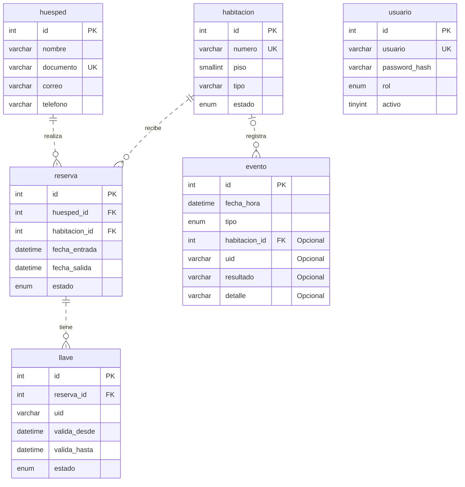

# Diagrama entidad-relación de Hotel RFID Web

El diagrama representa las seis tablas de [schema.sql](../../database/schema.sql). Las líneas discontinuas indican relaciones en las que la clave foránea queda fuera de la clave primaria de la tabla hija.

## Cardinalidades

| Relación | Cardinalidad |
| --- | --- |
| Huésped y reserva | Un huésped puede tener de cero a muchas reservas. Cada reserva corresponde a un huésped. |
| Habitación y reserva | Una habitación puede tener de cero a muchas reservas. Cada reserva corresponde a una habitación. |
| Reserva y llave | Una reserva puede tener de cero a muchas llaves a lo largo de su historial. Cada llave corresponde a una reserva. |
| Habitación y evento | Una habitación puede tener de cero a muchos eventos. Cada evento puede estar asociado a cero o una habitación. |

## Restricciones del esquema

- Las seis tablas usan `id` como clave primaria autoincremental. `usuario.usuario`, `habitacion.numero` y `huesped.documento` son únicos.
- Si se elimina una habitación vinculada a un evento, `ON DELETE SET NULL` conserva el evento y deja su `habitacion_id` en `NULL`. Una habitación con reservas asociadas está protegida por la clave foránea de `reserva`.
- `llave.uid` puede repetirse en el historial. `evento.uid` guarda el UID registrado como dato de bitácora, sin clave foránea a `llave`.
- `usuario` es una entidad independiente en el esquema. Un evento de inicio de sesión puede registrarse sin habitación.
- Las restricciones `CHECK` limitan `usuario.activo` a 0 o 1 y exigen que el inicio sea anterior al fin tanto en las reservas como en la vigencia de las llaves.
