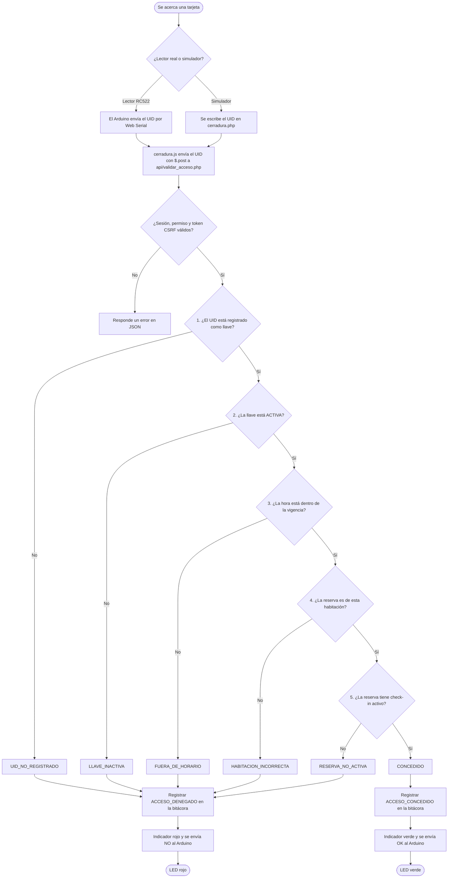
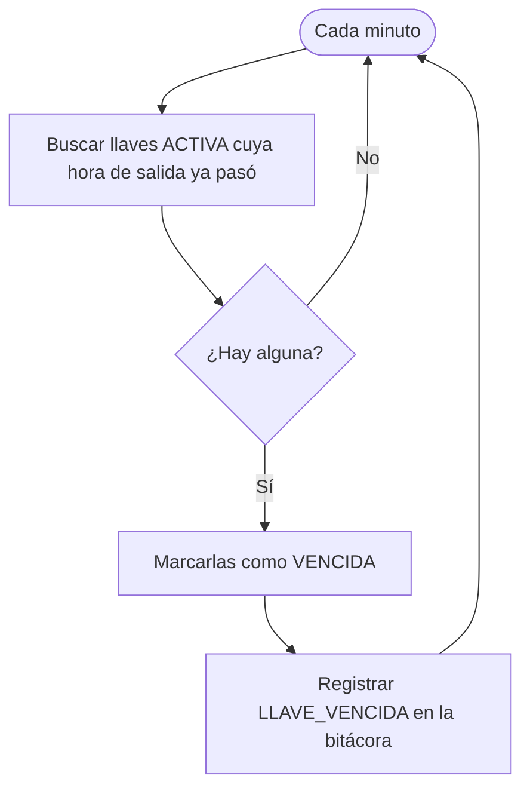

# Diagrama de flujo de la cerradura

Muestra lo que pasa desde que se acerca una tarjeta a la puerta hasta que se enciende el LED.
Lo implementan `cerradura.js`, `api/validar_acceso.php` y `CerraduraService::validar(...)`.

## Vencimiento automático de llaves

La tarea cron del hosting ejecuta `cron/expirar_llaves.php` cada minuto.

Una llave vencida ya no abre la puerta porque falla la regla 2.
